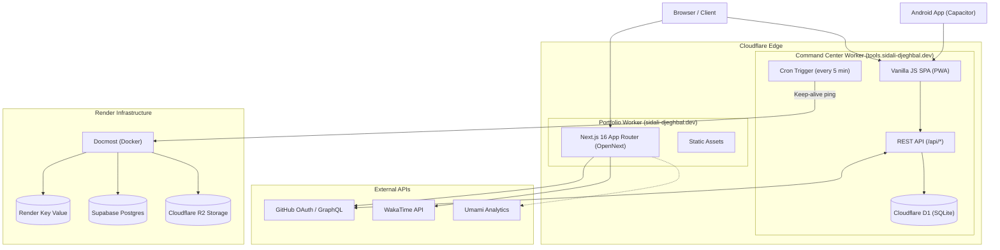

# sidali

Monorepo containing my personal portfolio, a serverless command center, a native Android companion app, and self-hosted documentation infrastructure.

- **Portfolio**: [sidali-djeghbal.dev](https://sidali-djeghbal.dev) — Next.js 16 app deployed on Cloudflare Workers via OpenNext.
- **Command Center**: [tools.sidali-djeghbal.dev](https://tools.sidali-djeghbal.dev) — Cloudflare Worker + D1 SQLite database serving a vanilla JS single-page app and REST API.
- **Android App**: Native Android container built with Capacitor 8 for the command center.
- **Docs**: [docs.sidali-djeghbal.dev](https://docs.sidali-djeghbal.dev) — Self-hosted Docmost instance on Render.

---

## System Design



### Architecture Details

1. **Portfolio (`app/`)**
   - Built on Next.js 16, React 19, and Tailwind CSS v4.
   - Compiled with the React Compiler (`babel-plugin-react-compiler`) and packaged for Cloudflare Workers using `@opennextjs/cloudflare`.
   - Uses React Server Components to fetch WakaTime stats on the server, while GitHub contribution stats are queried from a route handler (`/api/github-contributions`) via client-side SWR caching.
   - Includes a custom WebGL fluid dynamics canvas (`SplashCursor`) with Navier-Stokes solvers, disabled automatically when `prefers-reduced-motion` is active.
   - Page transitions and project preview hovers are animated with Motion and GSAP. Lenis handles smooth scrolling.
   - Analytics (Umami) are proxied through Next.js rewrites (`/umami.js`, `/api/send`) to prevent adblock blocking.

2. **Command Center (`tools/`)**
   - Single Cloudflare Worker (`tools/index.js`) serving static assets from `tools/public/` and handling `/api/*` requests.
   - Frontend is a vanilla JavaScript single-page app without build steps or external dependencies.
   - Features: Bookmarks with drag-and-drop reordering, Kanban task board, habit tracker with annual heatmap, reading log with daily session tracking, and infrastructure links.
   - PWA support via `manifest.webmanifest` and `sw.js`: stale-while-revalidate for static assets, network-first for GET requests, direct bypass for mutations and auth.
   - Cron trigger (`*/5 * * * *`) pings the Render Docmost instance to prevent free-tier containers from idling.

3. **Android Client (`android-app/`)**
   - Wraps `tools.sidali-djeghbal.dev` using Capacitor 8.
   - `MainActivity.java` enables third-party cookies on Android WebView to handle GitHub OAuth sessions properly.
   - Overrides `onBackPressed` to navigate the SPA view history instead of closing the application.

4. **Documentation Infrastructure (`render.yaml`)**
   - Deploys the official `docmost/docmost:latest` Docker image to Render (Frankfurt).
   - Uses Render Key Value (plain `redis://` protocol) to bypass Docmost's TLS Redis parser bug.
   - PostgreSQL hosted on Supabase, media attachments stored in Cloudflare R2 using the S3 driver.

### Authentication & Security

- **GitHub OAuth 2.0**: Sign-in is restricted to usernames in `GITHUB_ALLOWED_USERS`.
- **Anti-CSRF**: State tokens are generated cryptographically and validated via short-lived cookies (`cc_oauth_state`).
- **Session Tokens**: HMAC-SHA256 signatures (`<expiry>.<login>.<hmac>`) stored in an `HttpOnly`, `Secure`, `SameSite=Lax` cookie valid for 30 days.
- **Rate Limiting**: In-memory IP tracking limits `/api/auth/github` to 10 requests per 5 minutes.

### Database Schema (Cloudflare D1)

Managed via SQL migrations in `tools/migrations/`:

- `bookmarks`: `id`, `title`, `url`, `position` (float for drag-and-drop reordering), `created_at`.
- `tasks`: `id`, `title`, `notes`, `status` (`todo`, `doing`, `done`), `priority` (`none`, `low`, `med`, `high`), `position`, `completed_at`, `created_at`, `updated_at`.
- `habits`: `id`, `name`, `emoji`, `archived`, `created_at`.
- `habit_logs`: `habit_id` (foreign key), `day` (`YYYY-MM-DD`). Primary key `(habit_id, day)`.
- `books`: `id`, `title`, `author`, `status` (`want`, `reading`, `finished`), `progress`, `total_pages`, `current_page`, `started_at`, `finished_at`, `link`, `notes`, timestamps.
- `book_sessions`: `id`, `book_id` (foreign key), `day`, `pages`, `minutes`, `created_at`.

---

## Technologies Used

- **Frontend & Web**: Next.js 16, React 19, React Compiler, TypeScript, Tailwind CSS v4, MDX, Motion, GSAP, Lenis, SWR, Radix UI, date-fns, WebGL.
- **Command Center SPA**: Vanilla JavaScript (ES6), HTML5 Drag and Drop API, Service Worker API (PWA).
- **Mobile**: Capacitor 8, Android SDK, Gradle, Java 21.
- **Serverless & Database**: Cloudflare Workers, Cloudflare D1 (SQLite), Cloudflare R2 (S3 API), OpenNext Cloudflare adapter, Wrangler CLI.
- **Infrastructure & Storage**: Docker, Render, PostgreSQL (Supabase), Redis (Render Key Value).
- **Analytics & Telemetry**: Umami, LogRocket, Vercel Analytics, Vercel Speed Insights.
- **Tooling**: Bun, Biome, Husky, Lint-Staged, Renovate.

---

## Monorepo Layout

```
sidali/
├── app/                  # Next.js portfolio (sidali-djeghbal.dev)
│   ├── api/              # API routes (GitHub GraphQL proxy)
│   ├── components/       # UI components, WebGL canvas, analytics
│   ├── projects/         # Projects showcase
│   ├── stats/            # Live stats (GitHub + WakaTime)
│   └── uses/             # Uses page (MDX)
├── tools/                # Command Center (tools.sidali-djeghbal.dev)
│   ├── migrations/       # D1 database migrations (0001 to 0005)
│   ├── public/           # SPA assets, PWA manifest, service worker
│   ├── index.js          # Worker code: REST API, OAuth, Cron trigger
│   └── wrangler.jsonc    # Worker configuration
├── android-app/          # Capacitor Android container
│   ├── android/          # Native Android Gradle project
│   └── capacitor.config.ts
├── public/               # Static assets, robots, headers, llms.txt
├── biome.json            # Biome linting and formatting configuration
├── next.config.ts        # Next.js configuration and rewrites
├── open-next.config.ts   # OpenNext Cloudflare configuration
├── package.json          # Root dependencies and scripts
└── render.yaml           # Render blueprint for Docmost and Redis
```

---

## Local Development

### 1. Portfolio

```bash
bun install
cp .env.example .env.local
bun run dev
```

Optional variables in `.env.local`:
- `GITHUB_TOKEN`: For GitHub contribution calendar.
- `WAKATIME_SECRET_KEY`: For coding stats.
- `NEXT_PUBLIC_LOGROCKET_ID`: For session recording.
- `NEXT_PUBLIC_UMAMI_WEBSITE_ID` & `NEXT_PUBLIC_UMAMI_WEBSITE_URL`: For analytics.

App runs at `http://localhost:3000`.

### 2. Command Center

```bash
cd tools

# 1. Create tools/.dev.vars
cat << EOF > .dev.vars
GITHUB_CLIENT_ID=your-github-client-id
GITHUB_CLIENT_SECRET=your-github-client-secret
GITHUB_ALLOWED_USERS=your-username
LOCAL_ORIGIN=http://localhost:8787
EOF

# 2. Apply migrations to local D1
npx wrangler d1 execute sidali-notes --local --file migrations/0001_init.sql
npx wrangler d1 execute sidali-notes --local --file migrations/0002_command_center.sql
npx wrangler d1 execute sidali-notes --local --file migrations/0003_reading_tracker.sql
npx wrangler d1 execute sidali-notes --local --file migrations/0004_books_link.sql
npx wrangler d1 execute sidali-notes --local --file migrations/0005_tasks_priority.sql

# 3. Start local worker
npx wrangler dev --port 8787
```

App runs at `http://localhost:8787`.

### 3. Android App

Requires Java 21 and Android SDK.

```bash
cd android-app
bun x cap sync android
cd android
./gradlew assembleDebug
```

Output APK: `android-app/android/app/build/outputs/apk/debug/app-debug.apk`

---

## Deployment

### Portfolio (Cloudflare Workers)

```bash
bun run deploy
```

### Command Center (Cloudflare Worker + D1)

```bash
cd tools

# Set secrets
npx wrangler secret put GITHUB_CLIENT_ID
npx wrangler secret put GITHUB_CLIENT_SECRET
npx wrangler secret put GITHUB_ALLOWED_USERS

# Apply migrations to remote D1
npx wrangler d1 execute sidali-notes --remote --file migrations/0002_command_center.sql
npx wrangler d1 execute sidali-notes --remote --file migrations/0003_reading_tracker.sql
npx wrangler d1 execute sidali-notes --remote --file migrations/0004_books_link.sql
npx wrangler d1 execute sidali-notes --remote --file migrations/0005_tasks_priority.sql

# Deploy
npx wrangler deploy
```

### Docmost (Render)

1. Connect the repository in Render using **New > Blueprint Instance**.
2. Configure `DATABASE_URL` (Supabase Postgres) and `AWS_S3_*` (Cloudflare R2 keys) in the dashboard.
3. Deploy.

---

## Scripts

| Script | Purpose |
| :--- | :--- |
| `bun run dev` | Start Next.js development server |
| `bun run build` | Next.js production build |
| `bun run preview` | Build and preview Cloudflare Worker locally |
| `bun run deploy` | Build and deploy portfolio to Cloudflare Workers |
| `bun run check` | Run Biome lint checks |
| `bun run lint` | Run Biome and apply safe fixes |
| `bun run format` | Format codebase with Biome |
| `bun run cf-typegen` | Generate TypeScript types for Cloudflare bindings |
