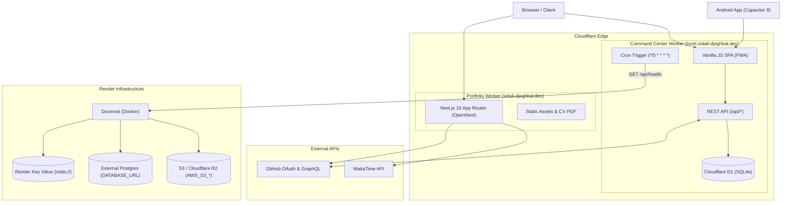

# sidali

[](https://nextjs.org/)
[](https://react.dev/)
[](https://www.typescriptlang.org/)
[](https://tailwindcss.com/)
[](https://workers.cloudflare.com/)
[](https://capacitorjs.com/)
[](https://pnpm.io/)
[](https://biomejs.dev/)

Monorepo containing my personal portfolio, a serverless personal command center, a Capacitor Android wrapper, and a Render blueprint for self-hosted documentation.

| Component | Location | Live URL | Stack |
| :--- | :--- | :--- | :--- |
| **Portfolio** | [`app/`](app/) | [sidali-djeghbal.dev](https://sidali-djeghbal.dev) | Next.js 16, React 19, Tailwind CSS v4, OpenNext on Cloudflare Workers |
| **Command Center** | [`tools/`](tools/) | [tools.sidali-djeghbal.dev](https://tools.sidali-djeghbal.dev) | Cloudflare Worker, D1 (SQLite), Vanilla ES6 SPA (PWA) |
| **Android App** | [`android-app/`](android-app/) | [`command-center.apk`](command-center.apk) | Capacitor 8 Android WebView wrapper |
| **Docs Blueprint** | [`render.yaml`](render.yaml) | [docs.sidali-djeghbal.dev](https://docs.sidali-djeghbal.dev) | Docmost Docker image + Render Key Value |

---

## System Architecture



---

## Components

### 1. Portfolio (`app/`)

- **Routes**:
  - `/` — Hero introduction, social links, interactive `SplashCursor`, and CV PDF download (`public/Sidali_Djeghbal_Frontend_Engineer.pdf`).
  - `/projects` — Selected projects (`app/projects/constants.ts`) with live demo / GitHub links, tech tags, and desktop hover preview modal (`GSAP` + `Motion`).
  - `/experience` — Work history, open-source maintenance, education, and CV download.
  - `/uses` — Hardware/software setup (`MDX`) plus categorized tech stack and soft skills.
  - `/stats` — Dynamic server-rendered (`force-dynamic`) WakaTime stats (`Promise.all` with 5s timeout) and client-side SWR GitHub contribution calendar via `/api/github-contributions`.
  - `/sitemap.xml` & `/robots.txt` — Generated via App Router metadata routes.
- **Runtime & Rendering**:
  - Next.js 16 (App Router) with React 19, React Compiler (`babel-plugin-react-compiler`), and Tailwind CSS v4, bundled for Cloudflare Workers via `@opennextjs/cloudflare`.
  - `SplashCursor` (`app/components/splash-cursor.tsx`): WebGL Navier-Stokes fluid canvas on `/`, disabled when `prefers-reduced-motion` is active on non-touch devices, initialized lazily on first pointer/touch interaction, paused after 3s idle, with DPR capped (`1` mobile / `1.5` desktop).
  - SEO & Analytics: JSON-LD (`Person` + `WebSite`), `public/llms.txt`, custom OG card (`scripts/og-image.svg` -> `public/og-image.png`), GTM/GA (`lazyOnload`), optional LogRocket (`NEXT_PUBLIC_LOGROCKET_ID`), and optional Umami rewrites (`/umami.js`, `/api/send`).

### 2. Command Center (`tools/`)

See [`tools/README.md`](tools/README.md) for the full endpoint reference and migration steps.

- **Worker & Static Assets (`tools/index.js`, `tools/wrangler.jsonc`)**:
  - Single Cloudflare Worker serving `tools/public/` via `ASSETS` (`run_worker_first: true`) with security headers (`X-Content-Type-Options`, `X-Frame-Options`, `Referrer-Policy`).
  - JSON REST API under `/api/*` backed by Cloudflare D1 (`sidali-notes`).
  - Cron trigger (`*/5 * * * *`) calling `https://docs.sidali-djeghbal.dev/api/health` to keep the Render Docmost container warm.
  - Also serves `tools/public/command-center.apk` as a static asset.
- **Frontend SPA & PWA (`tools/public/`)**:
  - Zero-build ES6 vanilla JS single-page app (`app.js`, `index.html`, `styles.css`) with bookmarks, Kanban tasks, habits + heatmap, and reading log + sessions.
  - Service worker (`sw.js`) uses stale-while-revalidate for static assets, network-first with cache fallback for `GET /api/*`, and network-only for `/api/auth/*`, `/api/logout`, and mutations.
- **Auth & Security**:
  - GitHub OAuth 2.0 restricted to usernames in `GITHUB_ALLOWED_USERS`.
  - Anti-CSRF `cc_oauth_state` cookie (`10m` TTL) and HMAC-SHA256 `cc_session` cookie (`HttpOnly`, `Secure`, `SameSite=Lax`, `30d` TTL).
  - In-memory per-IP rate limiting on `/api/auth/github` (10 requests per 5 minutes).
- **D1 Schema (`tools/migrations/0001`–`0005`)**:
  - `notes` (legacy from `0001`), `bookmarks`, `tasks` (with `status` and `priority`), `habits`, `habit_logs`, `books` (with `link`, `total_pages`, `current_page`), and `book_sessions`.

### 3. Android App (`android-app/`)

See [`android-app/README.md`](android-app/README.md) for install and build notes.

- Capacitor 8 container (`dev.sidalidjeghbal.commandcenter`) configured in [`android-app/capacitor.config.ts`](android-app/capacitor.config.ts) to load `https://tools.sidali-djeghbal.dev` (`www/index.html` acts as the fallback shell).
- [`MainActivity.java`](android-app/android/app/src/main/java/dev/sidalidjeghbal/commandcenter/MainActivity.java) enables third-party WebView cookies for GitHub OAuth and overrides `onBackPressed` to navigate WebView history before closing.
- Compiled debug APKs are kept at [`command-center.apk`](command-center.apk) and [`tools/public/command-center.apk`](tools/public/command-center.apk).

### 4. Documentation Infrastructure (`render.yaml`)

- Deploys `docmost/docmost:latest` to Render (`frankfurt`, `free` plan) paired with a Render Key Value instance (`redis-eu`, plain `redis://` connection).
- Requires external `DATABASE_URL` (Postgres) and `AWS_S3_ACCESS_KEY_ID` / `AWS_S3_SECRET_ACCESS_KEY` (configured for Cloudflare R2 S3-compatible storage).

---

## Monorepo Layout

```text
sidali/
├── app/                         # Next.js 16 portfolio (sidali-djeghbal.dev)
│   ├── api/github-contributions # GitHub GraphQL contribution proxy
│   ├── components/              # Hero, SplashCursor, WakaTime, GitHub graph, SEO, UI
│   ├── experience/              # Work experience, education & CV page
│   ├── projects/                # Projects showcase & hover preview
│   ├── stats/                   # Dynamic stats page (GitHub + WakaTime)
│   └── uses/                    # Setup (MDX) & skills page
├── tools/                       # Command Center Worker (tools.sidali-djeghbal.dev)
│   ├── migrations/              # D1 SQL migrations (0001 to 0005)
│   ├── public/                  # Vanilla JS SPA, PWA assets, command-center.apk
│   ├── index.js                 # Worker entrypoint (API, OAuth, cron)
│   └── wrangler.jsonc           # Worker & D1 configuration
├── android-app/                 # Capacitor 8 Android project
│   ├── android/                 # Native Android Gradle project
│   ├── www/                     # Minimal Capacitor fallback web dir
│   └── capacitor.config.ts
├── public/                      # Portfolio static assets, CV PDF, og-image.png, llms.txt
├── scripts/og-image.svg         # Source SVG for public/og-image.png
├── command-center.apk           # Prebuilt debug APK
├── package.json                 # Root scripts and dependencies
├── pnpm-workspace.yaml          # pnpm workspace (. and android-app)
├── biome.json                   # Biome linting & formatting config
├── next.config.ts               # Next.js config & optional Umami rewrites
├── open-next.config.ts          # OpenNext Cloudflare config
├── wrangler.jsonc               # Portfolio Cloudflare Worker config
└── render.yaml                  # Render blueprint for Docmost + Key Value
```

---

## Local Development

### Prerequisites

- Node.js & `pnpm` (`11.20.0`)
- Java 21 + Android SDK (only needed for building the Android APK)

### 1. Portfolio

```bash
pnpm install
cp .env.example .env.local
pnpm dev
```

Optional environment variables in `.env.local` (see `.env.example`):

- `GITHUB_TOKEN`: GitHub PAT for `/api/github-contributions`.
- `WAKATIME_SECRET_KEY`: WakaTime Personal OAuth Token (from `https://wakatime.com/oauth`) for `/stats`.
- `NEXT_PUBLIC_LOGROCKET_ID`: Enables LogRocket session replay in production.
- `NEXT_PUBLIC_UMAMI_WEBSITE_ID` & `NEXT_PUBLIC_UMAMI_WEBSITE_URL`: Enables Umami analytics and `/umami.js` + `/api/send` rewrites.

App runs at `http://localhost:3000`.

### 2. Command Center

```bash
cd tools

cat << EOF > .dev.vars
GITHUB_CLIENT_ID=your-github-client-id
GITHUB_CLIENT_SECRET=your-github-client-secret
GITHUB_ALLOWED_USERS=your-username
LOCAL_ORIGIN=http://localhost:8787
EOF

pnpm exec wrangler d1 execute sidali-notes --local --file migrations/0001_init.sql
pnpm exec wrangler d1 execute sidali-notes --local --file migrations/0002_command_center.sql
pnpm exec wrangler d1 execute sidali-notes --local --file migrations/0003_reading_tracker.sql
pnpm exec wrangler d1 execute sidali-notes --local --file migrations/0004_books_link.sql
pnpm exec wrangler d1 execute sidali-notes --local --file migrations/0005_tasks_priority.sql

pnpm exec wrangler dev --port 8787
```

App runs at `http://localhost:8787`.

### 3. Android App

```bash
cd android-app
pnpm exec cap sync android
cd android
JAVA_HOME=/usr/lib/jvm/java-21-openjdk ANDROID_HOME=$HOME/Android/Sdk ./gradlew assembleDebug
```

Output APK: `android-app/android/app/build/outputs/apk/debug/app-debug.apk`.

---

## Deployment

### Portfolio (Cloudflare Workers)

```bash
pnpm run deploy
```

Set runtime secrets (`GITHUB_TOKEN`, `WAKATIME_SECRET_KEY`) on the `sidali` Worker via `pnpm exec wrangler secret put`.

### Command Center (Cloudflare Worker + D1)

```bash
cd tools

pnpm exec wrangler secret put GITHUB_CLIENT_ID
pnpm exec wrangler secret put GITHUB_CLIENT_SECRET
pnpm exec wrangler secret put GITHUB_ALLOWED_USERS

pnpm exec wrangler d1 execute sidali-notes --remote --file migrations/0002_command_center.sql
pnpm exec wrangler d1 execute sidali-notes --remote --file migrations/0003_reading_tracker.sql
pnpm exec wrangler d1 execute sidali-notes --remote --file migrations/0004_books_link.sql
pnpm exec wrangler d1 execute sidali-notes --remote --file migrations/0005_tasks_priority.sql

pnpm exec wrangler deploy
```

### Docmost (Render)

1. Connect the repository in Render using **New > Blueprint Instance** (reads `render.yaml`).
2. Set `DATABASE_URL`, `AWS_S3_ACCESS_KEY_ID`, and `AWS_S3_SECRET_ACCESS_KEY` in the Render dashboard.
3. Deploy.

---

## Scripts

| Script | Purpose |
| :--- | :--- |
| `pnpm dev` | Start Next.js development server |
| `pnpm build` | Build Next.js production bundle |
| `pnpm serve` | Start Next.js Node production server |
| `pnpm preview` | Build and preview OpenNext Cloudflare Worker locally |
| `pnpm run deploy` | Build and deploy portfolio to Cloudflare Workers |
| `pnpm upload` | Build and upload OpenNext Worker bundle |
| `pnpm cf-typegen` | Generate TypeScript types for Cloudflare bindings |
| `pnpm check` | Run Biome lint & format checks |
| `pnpm lint` | Run Biome check with safe auto-fixes |
| `pnpm format` | Format codebase with Biome |
| `pnpm test` | Run Biome check and TypeScript (`tsc --noEmit`) |
| `pnpm db:backup` | Export remote D1 database (`sidali-notes`) to `d1-backup.sql` |
