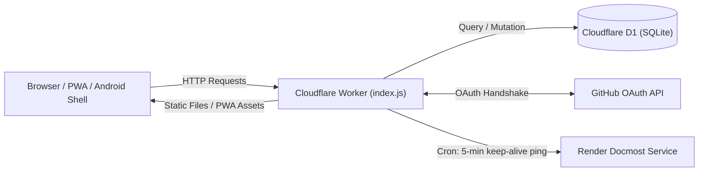

# Command Center (tools.sidali-djeghbal.dev)

A self-hosted personal productivity dashboard and REST API running as a single Cloudflare Worker with a Cloudflare D1 SQLite database and an installable Progressive Web App (PWA).

## Features

- **Launcher**: Aggregated daily view showing active tasks, habit completions, reading status, and quick bookmarks.
- **Start**: Visual bookmark manager with fractional drag-and-drop reordering and automatic favicon extraction.
- **Tasks**: Three-column Kanban board (`todo`, `doing`, `done`) with drag-and-drop, priority levels, and Markdown notes.
- **Habits**: Daily habit tracker with streak counters and a 365-day contribution heatmap.
- **Books**: Reading progress tracker with page-level logging, session history (pages and minutes read), and reading streaks.
- **Infra**: Quick dashboard links to cloud providers, databases, analytics, and repositories.
- **Docmost Keep-Alive**: Background cron trigger that periodically pings self-hosted documentation on Render to prevent cold starts.

---

## Architecture & System Design



### Components

1. **Edge Worker (`index.js`)**
   - Handles static file serving via `env.ASSETS` for the single-page application.
   - Provides a RESTful JSON API (`/api/*`) for data persistence on Cloudflare D1.
   - Executes scheduled tasks via `scheduled()` handler on a 5-minute cron interval.

2. **Vanilla SPA (`public/`)**
   - Built with plain ES6 JavaScript, HTML5, and CSS3 without build steps or frameworks.
   - Lightweight client-side hash router (`#start`, `#tasks`, `#habits`, `#books`, `#infra`).
   - Drag-and-drop reordering using standard HTML5 Drag and Drop API with fractional positioning.

3. **Service Worker & PWA (`public/sw.js`, `manifest.webmanifest`)**
   - Installable on desktop and mobile browsers.
   - Caching strategy:
     - Static assets: Stale-while-revalidate.
     - GET `/api/*`: Network-first with cache fallback.
     - POST / PUT / DELETE and `/api/auth/*`: Always network, never cached.

4. **Security & Authentication**
   - GitHub OAuth 2.0 flow restricted to usernames defined in `GITHUB_ALLOWED_USERS`.
   - CSRF protection using short-lived state cookies (`cc_oauth_state`).
   - Session management via HMAC-SHA256 tokens (`<exp>.<login>.<sig>`) stored in `HttpOnly`, `Secure`, `SameSite=Lax` cookies with a 30-day lifetime.
   - In-memory rate limiting restricting the OAuth start endpoint to 10 requests per 5 minutes per IP.

---

## Technologies Used

- **Runtime**: Cloudflare Workers (Edge compute, Node.js compatibility).
- **Database**: Cloudflare D1 (Serverless edge SQLite).
- **Cryptography**: Web Crypto API (`crypto.subtle` for HMAC-SHA256 and SHA-256).
- **Frontend**: Vanilla JavaScript (ES6+), Modern CSS (variables, dark/light themes), HTML5.
- **PWA**: Service Worker API, Web App Manifest.
- **Tooling**: Wrangler CLI v4 for deployment and local emulation.

---

## Directory Structure

```
tools/
├── index.js              # Edge Worker: API routing, auth, cron trigger
├── wrangler.jsonc        # Worker configuration, D1 binding, custom domain
├── migrations/           # D1 schema migrations
│   ├── 0001_init.sql
│   ├── 0002_command_center.sql
│   ├── 0003_reading_tracker.sql
│   ├── 0004_books_link.sql
│   └── 0005_tasks_priority.sql
└── public/               # Static SPA files (served via env.ASSETS)
    ├── app.js            # SPA logic, state, and hash router
    ├── index.html        # HTML shell and dialogs
    ├── styles.css        # Stylesheet
    ├── sw.js             # Service worker
    ├── manifest.webmanifest
    └── icons/            # App icons
```

---

## API Reference

| Endpoint | Method | Description |
| :--- | :--- | :--- |
| `/api/auth/github` | GET | Initiates GitHub OAuth flow with anti-CSRF state |
| `/api/auth/github/callback` | GET | OAuth callback; validates user allowlist and issues session |
| `/api/logout` | POST | Clears session cookie |
| `/api/session` | GET | Validates session and returns current user |
| `/api/bookmarks[/:id]` | GET, POST, PUT, DELETE | Manage bookmarks with fractional ordering |
| `/api/tasks[/:id]` | GET, POST, PUT, DELETE | Manage Kanban tasks (status, priority, position) |
| `/api/habits[/:id]` | GET, POST, PUT, DELETE | Manage habit definitions and archive states |
| `/api/habits/:id/toggle` | POST | Toggle completion for a given date (`{ day: "YYYY-MM-DD" }`) |
| `/api/books[/:id]` | GET, POST, PUT, DELETE | Manage reading list and page progress |
| `/api/books/:id/sessions` | POST | Log a reading session (`{ day, pages, minutes }`) |
| `/api/books/:id/sessions/:sid` | DELETE | Delete a specific reading session |

---

## Local Development

### 1. Configure `.dev.vars`

Create `tools/.dev.vars` (gitignored):

```ini
GITHUB_CLIENT_ID=your-local-client-id
GITHUB_CLIENT_SECRET=your-local-client-secret
GITHUB_ALLOWED_USERS=your-github-username
LOCAL_ORIGIN=http://localhost:8787
```

Note: `LOCAL_ORIGIN` ensures GitHub redirects back to `http://localhost:8787` instead of the production domain during local development. Register a dedicated local OAuth app in GitHub Developer Settings pointing to `http://localhost:8787/api/auth/github/callback`.

### 2. Apply Migrations to Local D1

```bash
npx wrangler d1 execute sidali-notes --local --file migrations/0001_init.sql
npx wrangler d1 execute sidali-notes --local --file migrations/0002_command_center.sql
npx wrangler d1 execute sidali-notes --local --file migrations/0003_reading_tracker.sql
npx wrangler d1 execute sidali-notes --local --file migrations/0004_books_link.sql
npx wrangler d1 execute sidali-notes --local --file migrations/0005_tasks_priority.sql
```

### 3. Start Local Development Server

```bash
npx wrangler dev --port 8787
```

Navigate to `http://localhost:8787`.

---

## Production Deployment

### 1. Set Production Secrets

```bash
npx wrangler secret put GITHUB_CLIENT_ID
npx wrangler secret put GITHUB_CLIENT_SECRET
npx wrangler secret put GITHUB_ALLOWED_USERS
```

### 2. Apply Migrations to Remote D1

```bash
npx wrangler d1 execute sidali-notes --remote --file migrations/0002_command_center.sql
npx wrangler d1 execute sidali-notes --remote --file migrations/0003_reading_tracker.sql
npx wrangler d1 execute sidali-notes --remote --file migrations/0004_books_link.sql
npx wrangler d1 execute sidali-notes --remote --file migrations/0005_tasks_priority.sql
```

### 3. Deploy Worker

```bash
npx wrangler deploy
```
